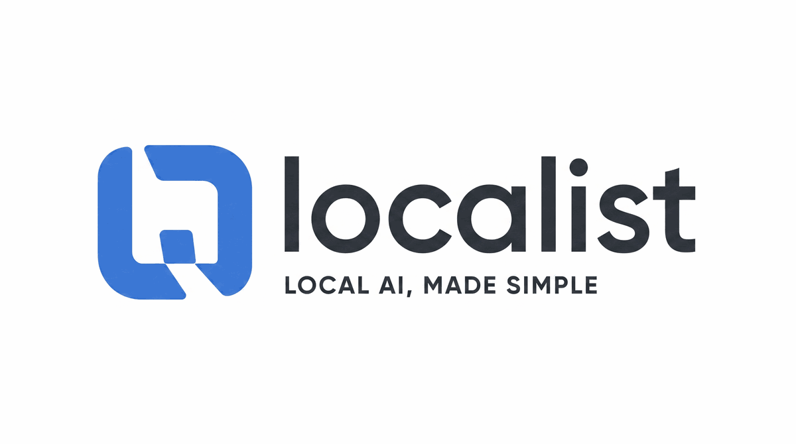
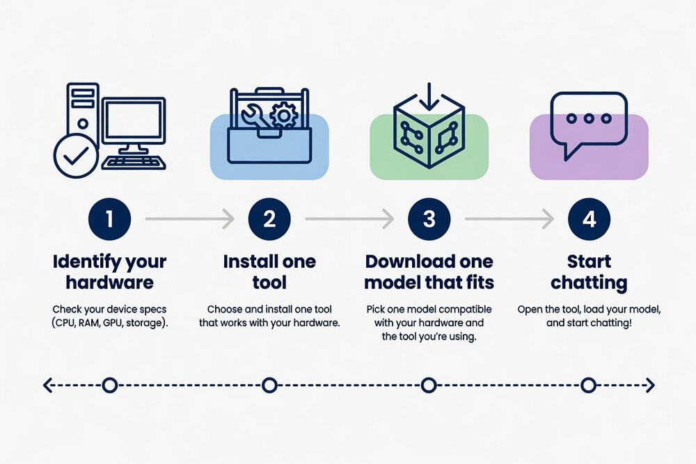

  

# Localist

> **Run AI on your own machine.** Pick your hardware, install one tool, chat with a model that fits — this page gets a beginner there in about 15 minutes.

  <a href="https://medium.com/p/dadded1dda24">Backstory</a> ·
  <a href="https://x.com/bokiko">Follow updates on X</a>

Localist is a beginner-first guide, not another giant tool list. You start from the
machine you already own, follow one guide, and skip the other 50 options. And it
doesn't rot: a pipeline — not vibes — refreshes the
[Fresh updates](#-fresh-updates) section every morning, and we review and prune
stale recommendations instead of hoarding them.

**Jump to:** [Start here](#-start-here--pick-your-hardware) ·
[The essentials](#-the-essentials) · [Fresh updates](#-fresh-updates) ·
[Glossary](guides/glossary.md) · [Contributing](#-contributing)

**Not sure what hardware you have?** → [Work it out in two questions](guides/start-here.md)
· **Something not working?** → [Troubleshooting](guides/troubleshooting.md)

---

## 🚀 Start here — pick your hardware

Don't read everything. Find your row, follow one guide, and you'll be chatting with a
local model in under 15 minutes.

  

| I have… | Your guide |
|---|---|
| **An NVIDIA GPU** (any GeForce RTX) | [NVIDIA GPU path](guides/nvidia-gpu.md) |
| **A Mac with Apple Silicon** (M-series) | [Mac path](guides/mac-apple-silicon.md) |
| **An AMD GPU** (Radeon RX) | [AMD GPU path](guides/amd-gpu.md) |
| **Just a laptop / no GPU** | [CPU-only path](guides/cpu-only.md) |
| **A mini PC or home server** | [CPU-only path](guides/cpu-only.md) — or the [NVIDIA path](guides/nvidia-gpu.md) if it has a GPU |
| **No idea what I have** | [Start here](guides/start-here.md) |

Everything here can run locally; many paths work offline after setup, and your
prompts stay on your machine unless you connect a cloud service.

**Stuck partway?** [Troubleshooting](guides/troubleshooting.md) covers the handful of
things that actually go wrong — including *"where do I type this command?"*, how to
stop the chat, and how to start it again tomorrow.

---

## 🧰 The essentials

One opinionated pick per category. Alternatives are inside each entry — but if
you're new, just take the pick and move on.

**Which tool first?** Want clicks? Start with LM Studio. Comfortable with one
command? Start with Ollama. You do not need both.

| Category | Our pick | Why this one |
|---|---|---|
| **Model runner** | [Ollama](https://github.com/ollama/ollama) | One command to install, one to run a model. The de-facto beginner standard. |
| **Desktop app** | [LM Studio](https://lmstudio.ai) | Point-and-click everything: browse, download, and chat with models. No terminal needed. |
| **Web UI** | [Open WebUI](https://github.com/open-webui/open-webui) | ChatGPT-style interface on top of Ollama. Multi-user, chat with your documents, voice. |
| **Chat models** | [Qwen3 family](https://ollama.com/library/qwen3) | Strong at every size, tiny to huge. Which size fits you → [choosing models](guides/choosing-models.md). |
| **Coding models** | [Qwen Coder](https://ollama.com/library/qwen3-coder) | Same idea, meaningfully better at code. Pairs with the coding agent below. |
| **Coding agent** | [OpenCode](https://github.com/anomalyco/opencode) | Most popular open-source coding agent; points at your local models. |
| **Image generation** | [ComfyUI](https://github.com/Comfy-Org/ComfyUI) | Node-based, runs every major open image model. Steeper curve, unmatched power. |
| **Chat with your docs** | [AnythingLLM](https://github.com/Mintplex-Labs/anything-llm) | Point it at a folder and a local model — done. |
| **Speech-to-text** | [whisper.cpp](https://github.com/ggml-org/whisper.cpp) | Fast local transcription on any hardware. |
| **Text-to-speech** | [Piper](https://github.com/OHF-Voice/piper1-gpl) | Fast, natural offline voices — runs even on a Raspberry Pi. |

When you outgrow beginner tools, [llama.cpp](https://github.com/ggml-org/llama.cpp)
is the engine worth learning — it's what most of the tools above are built on.

The full curated set (with licenses, hardware fit, and honest caveats) lives in
[`data/curated.yml`](data/curated.yml) — it's the single source of truth these
picks come from.

---

## 🔥 Fresh updates

New projects and tool releases from the past week, refreshed daily by the pipeline.
*Pipeline-surfaced projects are not curated recommendations. Start with the
Essentials table above if you want the trusted beginner picks.*

<!-- NEWS:START -->
*Updated 2026-10-16*

**🆕 New & active projects**
- [leemysw/yovoice](https://github.com/leemysw/yovoice) — Open-source local AI audio & music studio for macOS & Windows. TTS, voice cloning, songs with lyrics, and multi-track scores — 100% offline, zero API fees. · ⭐ 1247
- [Ryder-Sun/Meldwork](https://github.com/Ryder-Sun/Meldwork) — Local-first AI agent workspace for multi-agent collaboration, agent orchestration, scoped permissions, evidence-aware runs, and human-in-the-loop decisions. · ⭐ 832
- [openbin-ai/binny](https://github.com/openbin-ai/binny) — BINNY: an open source agent harness for reverse engineering. Plug in any model, or a local one. · ⭐ 87
- [VecSzn/PolyStrata](https://github.com/VecSzn/PolyStrata) — Run large AI models on your own PC: Qwen3.8-Flash-Next, GLM 5.3 Flash, Qwen3.6, Ornith 1.5 and Gemma 4. One-click install for Windows and Linux, OpenAI/Anthropic API on localhost, image input. Built · ⭐ 64
- [anisayari/sparky](https://github.com/anisayari/sparky) — 🔒 Your private AI assistant, 100% local on Windows: chat, vision, documents (RAG), web search, images, videos with sound, voice, code projects, MCP tools — one-line install, models picked for your PC. · ⭐ 39

**📦 Tool releases**
- [LM Studio 1.1.8](https://lmstudio.ai/changelog/bionic-v1.1.8)
- [Ollama v0.40.3](https://github.com/ollama/ollama/releases/tag/v0.40.3) — `ollama launch claude` no longer shows a warning about Claude connectors `ollama launch codex` no longer warns about service tiers
- [Open WebUI v0.12.0](https://github.com/open-webui/open-webui/releases/tag/v0.12.0) — Added ☎️ **Realtime voice calls.** Administrators can now switch Call mode in the Voice calls section of Audio settings from Standard to Realtime, so Voice mode talks through an OpenAI Realtime voice
- [Ollama v0.40.4](https://github.com/ollama/ollama/releases/tag/v0.40.4) — Decision models in the CLI Decision models can now be used directly from the terminal with `ollama run` — ask yes/no questions, classify text into labels, or score against a rubric:
- [KoboldCpp v1.123](https://github.com/LostRuins/koboldcpp/releases/tag/v1.123) — **NEW: [Introducing koboldcpp.net, our new community website]( - KoboldCpp now has an official **community website**! This is a legitimate community site put together with the help of @Autumnlight02
- [ComfyUI v0.40.0](https://github.com/Comfy-Org/ComfyUI/releases/tag/v0.40.0) — [Server.py] Update CSP to allow `blob:` and `data:` Add comfy_attention and AttentionTensorContainer support to rest of models
- [Open WebUI v0.12.2](https://github.com/open-webui/open-webui/releases/tag/v0.12.2) — Added 📑 **MinerU 4.x servers.** The MinerU document engine now works with self-hosted MinerU 4.x servers, where every document failed with a 404 because 4.x removed the old parsing interface; 3.x
- [Open WebUI v0.12.1](https://github.com/open-webui/open-webui/releases/tag/v0.12.1) — Added 🧱 **External apps in channels.** Administrators can now turn on Apps in Admin Settings > General, or with "ENABLE_APPS", and connect external apps in the new Apps tab of Admin Settings by their
- [Ollama v0.40.5](https://github.com/ollama/ollama/releases/tag/v0.40.5) — NVIDIA Nemotron 3.5 Super [NVIDIA Nemotron 3.5 Super]( is a vision-language model for coding, reasoning, tool use, and document understanding. It pairs a 120B-parameter hybrid Mamba-2/Transformer
- [KoboldCpp v1.123.1](https://github.com/LostRuins/koboldcpp/releases/tag/v1.123.1) — **NEW: [Introducing koboldcpp.net, our new community website]( - KoboldCpp now has an official **community website**! This is a legitimate community site put together with the help of @Autumnlight02
- [ComfyUI v0.41.0](https://github.com/Comfy-Org/ComfyUI/releases/tag/v0.41.0) — Add ImageSDRToHDR node. feat: Add a core route for the default workflow (CORE-340)
<!-- NEWS:END -->

[Full news archive →](news/)

---

## 📚 New to all of this?

Don't know what hardware you have? [Start here](guides/start-here.md) works it out in
two questions, and tells you what a local model will and won't do well before you
spend time on it.

The [glossary](guides/glossary.md) explains every term you'll bump into —
GGUF, quantization, weights, context window, VRAM, tokens/sec — in plain words.
And [choosing models](guides/choosing-models.md) answers the #1 question:
*which model size actually fits my machine?*

When something doesn't work, [troubleshooting](guides/troubleshooting.md) is organised
by what you see on screen — not by what went wrong underneath.

## 🤝 Contributing

Found a great tool? Spotted a dead project? Open an issue —
[suggest a tool](https://github.com/bokiko/localist/issues/new?template=suggest-tool.yml) ·
[report a stale entry](https://github.com/bokiko/localist/issues/new?template=report-stale.yml).
If a link, download, or command looks unsafe or compromised, report it privately
through [SECURITY.md](SECURITY.md) instead of a public issue.
See [CONTRIBUTING.md](CONTRIBUTING.md) for the ground rules.

## 📄 License

- Code and scripts: [MIT](LICENSE)
- Guides and written content: [CC-BY-4.0](LICENSE-CONTENT)
